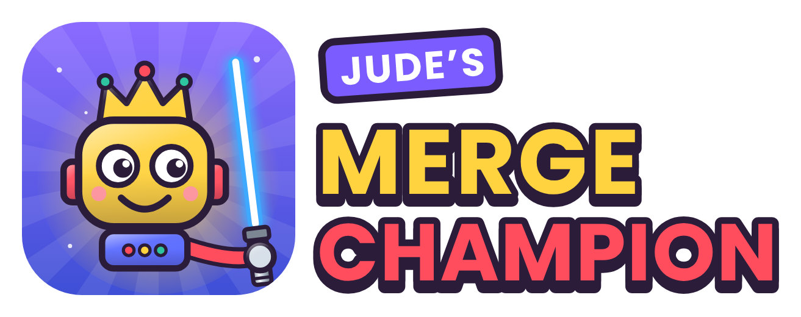

# Jude's Merge Champion

A robot building and battle game designed by Jude (age 8).

Build your own robot from everyday parts, paint it, give it a name, then battle computer robots to win gold coins. Spend coins to upgrade parts from level 1 to 10. Level your robot up to unlock 10 Power Parts, two at a time.

**Play:** https://mickrobbo.github.io/judes-merge-champion/

- The whole game is one file: `index.html`.
- Progress (coins, parts, upgrades) saves in the browser on each device.
- On Netlify, the leaderboard and player challenges run on a small server function, `netlify/functions/api.mjs`, which stores players and challenges in Netlify Blobs. Each device becomes a player automatically: no logins.
- On GitHub Pages there is no server, so the game plays fully but the leaderboard shows a note instead.

## Looking after the leaderboard

Players and challenges are in **Netlify → Data & Storage → Blobs → `merge-champion`**. To remove a robot (for example a rude name), delete its `players/<id>` entry there.

## Installing as an app

The Netlify site is an installable web app. In Chrome on a phone, open the site and tap **Install** (or ⋮ → **Install app** / **Add to Home screen**). It opens full screen with its own icon and still loads without internet; the leaderboard needs a connection.

- `manifest.webmanifest` – app name, colours and icons.
- `sw.js` – offline support. Bump `CACHE` when you want installed copies to refresh their saved files.
- `icons/` – app icons (normal, maskable for Android, Apple touch icon, favicon).
- `brand/` – the logo (`logo.svg`, `logo.png`).

## Adding to the game

Open `index.html` and look near the top of the `<script>`:

- `OBJECTS` – the parts. Add one here plus an icon in `ICONS`.
- `SPECIALS` – what each part's special move does.
- `COMBOS` – secret combos.
- `WEAPONS` – laser swords (colour, stats, price, special move). Their special moves are in `SPECIALS` too.
- `STYLES` – robot styles (Classic, Star Knight, Shadow Lord, Rocket Pilot, Scrap Scout), drawn in `robotSVG`.
- The economy constants (coin rewards, upgrade cost, XP per level) sit just above.
